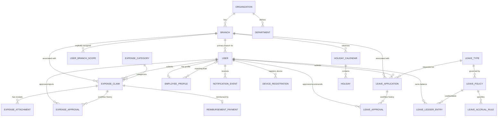

# Great Waters — Database Architecture & Entity Relationship Design

**Database Engine:** PostgreSQL 15+  
**Schema Namespace:** `public`  
**Timezone:** UTC (`TIME_ZONE = 'UTC'`, `USE_TZ = True`)  

---

## 1. Entity Relationship Diagram (ERD)

---

## 2. Table Specifications

### 2.1 Identity, Organization & Access Control

#### `accounts_user` (CustomUser)
Custom user model extending `AbstractUser`. Created before first migration.
- `id`: BigAutoField, Primary Key
- `employee_id`: VARCHAR(30), Unique, Indexed. E.g., `GW-001`.
- `email`: EmailField, Unique, Indexed.
- `first_name`: VARCHAR(150)
- `last_name`: VARCHAR(150)
- `role`: VARCHAR(30), Choice: `EMPLOYEE`, `LEAD_MANAGER`, `ADMIN_MANAGER`, `HR_COORDINATOR`, `DIRECTOR`.
- `is_global_scope`: BOOLEAN, Default `False`. If `True`, grants organization-wide view across all branches (subject to role permissions).
- `primary_branch_id`: ForeignKey(`organization_branch`, on_delete=SET_NULL, null=True, related_name='primary_employees')
- `is_active`: BOOLEAN, Default `True`
- `created_at`: DateTimeField(auto_now_add=True)
- `updated_at`: DateTimeField(auto_now=True)

#### `organization_organization`
- `id`: BigAutoField, Primary Key
- `name`: VARCHAR(255), Default `'Great Waters'`
- `code`: VARCHAR(50), Unique
- `currency_code`: VARCHAR(10), Default `'USD'`
- `currency_symbol`: VARCHAR(10), Default `'$'`
- `contact_email`: VARCHAR(255)
- `contact_phone`: VARCHAR(50)
- `created_at`: DateTimeField(auto_now_add=True)

#### `organization_branch`
- `id`: BigAutoField, Primary Key
- `organization_id`: ForeignKey(`organization_organization`, on_delete=CASCADE)
- `code`: VARCHAR(20), Unique, Indexed (e.g., `GW-DXB`, `GW-KCH`, `GW-SGP`)
- `name`: VARCHAR(255), Indexed
- `address`: TEXT
- `city`: VARCHAR(100)
- `country`: VARCHAR(100)
- `phone`: VARCHAR(50)
- `is_active`: BOOLEAN, Default `True`, Indexed
- `created_at`: DateTimeField(auto_now_add=True)

#### `organization_department`
- `id`: BigAutoField, Primary Key
- `organization_id`: ForeignKey(`organization_organization`, on_delete=CASCADE)
- `code`: VARCHAR(20), Unique
- `name`: VARCHAR(100)
- `is_active`: BOOLEAN, Default `True`

#### `accounts_user_branch_scope`
Explicit cross-branch access assignment for Managers, HR Coordinators, and Admin Managers.
- `id`: BigAutoField, Primary Key
- `user_id`: ForeignKey(`accounts_user`, on_delete=CASCADE, related_name='branch_scopes')
- `branch_id`: ForeignKey(`organization_branch`, on_delete=CASCADE, related_name='assigned_users')
- `can_manage_expenses`: BOOLEAN, Default `True`
- `can_manage_leaves`: BOOLEAN, Default `True`
- `created_at`: DateTimeField(auto_now_add=True)
- *Constraint:* Unique(`user_id`, `branch_id`)

#### `accounts_employee_profile`
- `id`: BigAutoField, Primary Key
- `user_id`: OneToOneField(`accounts_user`, on_delete=CASCADE, related_name='profile')
- `department_id`: ForeignKey(`organization_department`, on_delete=SET_NULL, null=True)
- `designation`: VARCHAR(100)
- `reporting_lead_id`: ForeignKey(`accounts_user`, on_delete=SET_NULL, null=True, related_name='direct_reports')
- `date_of_joining`: DateField, Indexed
- `phone_number`: VARCHAR(30)
- `emergency_contact`: VARCHAR(100)
- `pan_or_national_id`: VARCHAR(50), Null=True
- `bank_name`: VARCHAR(100), Null=True
- `bank_account_no`: VARCHAR(50), Null=True
- `bank_ifsc_or_swift`: VARCHAR(50), Null=True

---

### 2.2 Expense Management Entities

#### `expenses_expense_category`
- `id`: BigAutoField, Primary Key
- `organization_id`: ForeignKey(`organization_organization`, on_delete=CASCADE)
- `name`: VARCHAR(100) (e.g., Travel, Food, Accommodation, Fuel, Office Supplies)
- `code`: VARCHAR(50), Unique
- `description`: TEXT, Blank=True
- `is_active`: BOOLEAN, Default `True`

#### `expenses_expense_claim`
- `id`: BigAutoField, Primary Key
- `claim_number`: VARCHAR(50), Unique, Indexed (e.g., `EXP-202610-0012`)
- `employee_id`: ForeignKey(`accounts_user`, on_delete=PROTECT, related_name='expense_claims')
- `branch_id`: ForeignKey(`organization_branch`, on_delete=PROTECT, related_name='expense_claims')
- `category_id`: ForeignKey(`expenses_expense_category`, on_delete=PROTECT, related_name='expense_claims')
- `expense_date`: DateField, Indexed
- `amount`: DecimalField(max_digits=12, decimal_places=2)
- `description`: TEXT
- `project_reference`: VARCHAR(100), Blank=True
- `status`: VARCHAR(30), Indexed:
  - `DRAFT`
  - `UNDER_ADMIN_REVIEW`
  - `UNDER_DIRECTOR_REVIEW`
  - `APPROVED_BY_DIRECTOR`
  - `PAID`
  - `REJECTED_BY_ADMIN`
  - `REJECTED_BY_DIRECTOR`
  - `WITHDRAWN`
- `submitted_at`: DateTimeField(null=True, blank=True)
- `created_at`: DateTimeField(auto_now_add=True)
- `updated_at`: DateTimeField(auto_now=True)

#### `expenses_expense_attachment`
- `id`: BigAutoField, Primary Key
- `claim_id`: ForeignKey(`expenses_expense_claim`, on_delete=CASCADE, related_name='attachments')
- `file`: FileField(upload_to='receipts/%Y/%m/')
- `original_filename`: VARCHAR(255)
- `file_type`: VARCHAR(50) (e.g., image/jpeg, image/png, application/pdf)
- `file_size`: IntegerField (in bytes)
- `uploaded_at`: DateTimeField(auto_now_add=True)

#### `expenses_expense_approval`
- `id`: BigAutoField, Primary Key
- `claim_id`: ForeignKey(`expenses_expense_claim`, on_delete=CASCADE, related_name='approval_history')
- `stage`: VARCHAR(30) (`ADMIN_MANAGER`, `DIRECTOR`)
- `approver_id`: ForeignKey(`accounts_user`, on_delete=PROTECT)
- `action`: VARCHAR(30) (`APPROVED`, `REJECTED`, `RETURNED`)
- `remarks`: TEXT, Blank=True
- `created_at`: DateTimeField(auto_now_add=True)

#### `expenses_reimbursement_payment`
- `id`: BigAutoField, Primary Key
- `claim_id`: OneToOneField(`expenses_expense_claim`, on_delete=PROTECT, related_name='payment_record')
- `recorded_by_id`: ForeignKey(`accounts_user`, on_delete=PROTECT)
- `payment_date`: DateField, Indexed
- `payment_mode`: VARCHAR(30) (`BANK_TRANSFER`, `CHEQUE`, `CASH`, `CORPORATE_CARD`)
- `payment_reference`: VARCHAR(100), Indexed (e.g., UTR / Transaction No / Cheque No)
- `remarks`: TEXT, Blank=True
- `created_at`: DateTimeField(auto_now_add=True)

---

### 2.3 Leave Management & Accrual Entities

#### `leaves_leave_type`
- `id`: BigAutoField, Primary Key
- `organization_id`: ForeignKey(`organization_organization`, on_delete=CASCADE)
- `name`: VARCHAR(50) (e.g., `Earned Leave`, `Casual Leave`, `Sick Leave`, `Unpaid Leave`)
- `code`: VARCHAR(20), Unique (e.g., `EL`, `CL`, `SL`, `LWP`)
- `is_paid`: BOOLEAN, Default `True`
- `is_accrual_based`: BOOLEAN, Default `False` (True for Earned Leave)
- `requires_attachment`: BOOLEAN, Default `False`
- `is_active`: BOOLEAN, Default `True`

#### `leaves_leave_policy`
- `id`: BigAutoField, Primary Key
- `leave_type_id`: ForeignKey(`leaves_leave_type`, on_delete=CASCADE, related_name='policies')
- `name`: VARCHAR(100)
- `yearly_entitlement`: DecimalField(max_digits=5, decimal_places=2) (e.g., 18.00 days)
- `accrual_frequency`: VARCHAR(20) (`MONTHLY`, `YEARLY`, `NONE`)
- `monthly_accrual_rate`: DecimalField(max_digits=4, decimal_places=2, default=0.00) (e.g., 1.50)
- `max_carry_forward`: DecimalField(max_digits=5, decimal_places=2, default=0.00)
- `probation_period_months`: IntegerField(default=0)
- `effective_date`: DateField
- `is_active`: BOOLEAN, Default `True`

#### `leaves_leave_accrual_run`
Tracks safe, idempotent accrual runs preventing duplicate credits.
- `id`: BigAutoField, Primary Key
- `employee_id`: ForeignKey(`accounts_user`, on_delete=CASCADE, related_name='accrual_runs')
- `policy_id`: ForeignKey(`leaves_leave_policy`, on_delete=PROTECT)
- `period_key`: VARCHAR(20), Indexed (e.g., `2026-10`, `2026-Q3`, `2026`)
- `days_credited`: DecimalField(max_digits=4, decimal_places=2)
- `executed_at`: DateTimeField(auto_now_add=True)
- *Constraint:* Unique(`employee_id`, `policy_id`, `period_key`)

#### `leaves_leave_ledger_entry`
Immutable transaction ledger for all leave balance mutations.
- `id`: BigAutoField, Primary Key
- `employee_id`: ForeignKey(`accounts_user`, on_delete=CASCADE, related_name='ledger_entries')
- `leave_type_id`: ForeignKey(`leaves_leave_type`, on_delete=PROTECT)
- `entry_type`: VARCHAR(30) (`OPENING_BALANCE`, `ACCRUAL_CREDIT`, `LEAVE_DEDUCTION`, `MANUAL_ADJUSTMENT`, `CARRY_FORWARD`, `LAPSED`)
- `transaction_days`: DecimalField(max_digits=5, decimal_places=2) (+ for credit, - for debit)
- `balance_after`: DecimalField(max_digits=6, decimal_places=2)
- `reference_note`: VARCHAR(255)
- `created_by_id`: ForeignKey(`accounts_user`, on_delete=SET_NULL, null=True)
- `created_at`: DateTimeField(auto_now_add=True)

#### `leaves_leave_application`
- `id`: BigAutoField, Primary Key
- `application_number`: VARCHAR(50), Unique, Indexed (e.g., `LV-202610-0045`)
- `employee_id`: ForeignKey(`accounts_user`, on_delete=PROTECT, related_name='leave_applications')
- `branch_id`: ForeignKey(`organization_branch`, on_delete=PROTECT, related_name='leave_applications')
- `leave_type_id`: ForeignKey(`leaves_leave_type`, on_delete=PROTECT)
- `start_date`: DateField, Indexed
- `end_date`: DateField, Indexed
- `is_half_day`: BOOLEAN, Default `False`
- `half_day_period`: VARCHAR(20), Blank=True (`FIRST_HALF`, `SECOND_HALF`)
- `number_of_days`: DecimalField(max_digits=4, decimal_places=2)
- `reason`: TEXT
- `attachment`: FileField(upload_to='leaves/%Y/%m/', null=True, blank=True)
- `status`: VARCHAR(35), Indexed:
  - `PENDING_LEAD_RECOMMENDATION`
  - `PENDING_HR_VERIFICATION`
  - `PENDING_DIRECTOR_APPROVAL`
  - `APPROVED`
  - `REJECTED_BY_LEAD`
  - `REJECTED_BY_HR`
  - `REJECTED_BY_DIRECTOR`
  - `WITHDRAWN`
- `submitted_at`: DateTimeField(auto_now_add=True)
- `updated_at`: DateTimeField(auto_now=True)

#### `leaves_leave_approval`
- `id`: BigAutoField, Primary Key
- `application_id`: ForeignKey(`leaves_leave_application`, on_delete=CASCADE, related_name='approval_history')
- `stage`: VARCHAR(30) (`LEAD_MANAGER`, `HR_COORDINATOR`, `DIRECTOR`)
- `approver_id`: ForeignKey(`accounts_user`, on_delete=PROTECT)
- `action`: VARCHAR(30) (`RECOMMENDED`, `VERIFIED`, `APPROVED`, `REJECTED`, `RETURNED`)
- `remarks`: TEXT, Blank=True
- `created_at`: DateTimeField(auto_now_add=True)

#### `leaves_holiday_calendar` & `leaves_holiday`
- `leaves_holiday_calendar`:
  - `id`: BigAutoField, Primary Key
  - `name`: VARCHAR(100) (e.g., `UAE 2026 Holidays`, `India 2026 Holidays`)
  - `year`: IntegerField
  - `branch_id`: ForeignKey(`organization_branch`, on_delete=CASCADE, related_name='holiday_calendars')
- `leaves_holiday`:
  - `id`: BigAutoField, Primary Key
  - `calendar_id`: ForeignKey(`leaves_holiday_calendar`, on_delete=CASCADE, related_name='holidays')
  - `date`: DateField, Indexed
  - `name`: VARCHAR(100)
  - `is_optional`: BOOLEAN, Default `False`

---

### 2.4 Notifications & Audit Entities

#### `notifications_notification_event`
- `id`: BigAutoField, Primary Key
- `recipient_id`: ForeignKey(`accounts_user`, on_delete=CASCADE, related_name='notifications')
- `title`: VARCHAR(200)
- `message`: TEXT
- `event_type`: VARCHAR(50) (e.g., `EXPENSE_SUBMITTED`, `EXPENSE_APPROVED`, `LEAVE_RECOMMENDED`, `PAYMENT_RECORDED`)
- `link_url`: VARCHAR(255), Blank=True
- `is_read`: BOOLEAN, Default `False`, Indexed
- `created_at`: DateTimeField(auto_now_add=True, Indexed=True)

#### `notifications_device_registration`
Stores FCM push tokens for iOS & Android mobile devices.
- `id`: BigAutoField, Primary Key
- `user_id`: ForeignKey(`accounts_user`, on_delete=CASCADE, related_name='devices')
- `registration_token`: VARCHAR(500), Unique, Indexed
- `device_type`: VARCHAR(20) (`ANDROID`, `IOS`)
- `device_model`: VARCHAR(100), Blank=True
- `app_version`: VARCHAR(30), Blank=True
- `is_active`: BOOLEAN, Default `True`
- `last_seen_at`: DateTimeField(auto_now=True)
- `created_at`: DateTimeField(auto_now_add=True)

---

## 3. Database Indexing & Integrity Strategy
1. **Multi-Column Unique Constraints:**
   - `leaves_leave_accrual_run`: `(employee_id, policy_id, period_key)` ensures strict prevention of duplicate credits.
   - `accounts_user_branch_scope`: `(user_id, branch_id)` prevents redundant permission records.
2. **Performance Indexes:**
   - `accounts_user.employee_id`, `accounts_user.email`
   - `expenses_expense_claim(branch_id, status, expense_date)`
   - `leaves_leave_application(branch_id, status, start_date)`
   - `notifications_notification_event(recipient_id, is_read, created_at)`
3. **Transactions (`atomic`):**
   - All state transitions (approval, rejection, leave ledger deduction, payment recording) run inside `transaction.atomic()` to guarantee ACID compliance.
