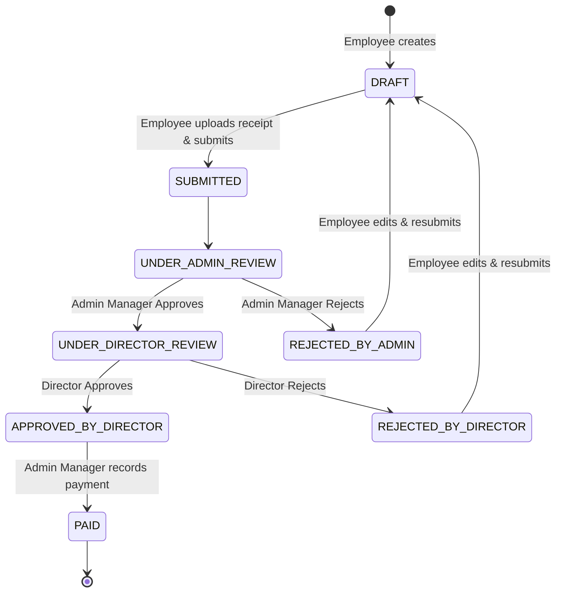
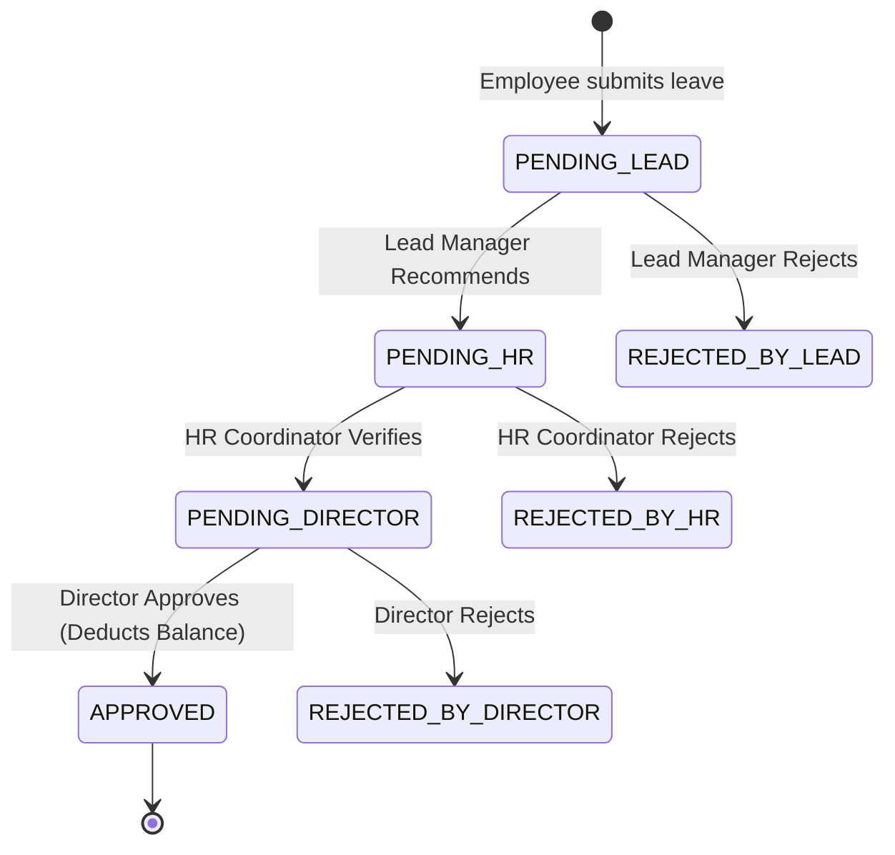

# Great Waters — Employee Expense & Leave Management System
## Software Requirements Specification (SRS) & Compliance Baseline

**Client:** Great Waters  
**Project:** Employee Expense & Leave Management System (Web Portal + Mobile App + REST API)  
**Document Version:** 2.0 (Aligned with Proposal & Architectural Specifications)  
**Status:** Approved Architecture Baseline  

---

## 1. System Overview & Objectives
Great Waters requires an enterprise-grade multi-branch Employee Expense and Leave Management System to replace informal paper, WhatsApp, and spreadsheet-based tracking with a unified, auditable, and secure platform.

The system encompasses:
1. **Core Backend & REST API:** Django 5, Django REST Framework, PostgreSQL, SimpleJWT, Celery/Background workers, FCM and Email notifications.
2. **Web Management Portal:** Django Server-Side Templates, Bootstrap 5, Custom CSS/JS Design System, Chart.js, responsive layouts for desktop, tablet, and mobile browsers.
3. **Mobile Application:** React Native (iOS & Android from a shared codebase), secure device storage, offline/retry resilience, receipt capture/gallery/PDF uploads, push notifications.
4. **Multi-Branch Organization Scope:** Strict branch isolation and organization-wide consolidated administration.

---

## 2. Organization, Branch & Multi-Tenant Access Control

### 2.1 Organizational Hierarchy
- **Organization Master:** Great Waters entity profile, fiscal year settings, currency (USD/INR/AED as configured).
- **Branch Master:** Office code, branch name, address, contact details, active/inactive status.
- **Department Master:** Department name, code, active status.

### 2.2 Access Scopes
- **Branch-Scoped:** Users can view, edit, and approve only records strictly within their authorized branch(es). Enforced via server-side querysets, service layer boundaries, and API permissions.
- **Organization-Wide (Global Scope):** Explicitly authorized users can view cross-branch consolidated dashboards, filter by single/multiple branches, and manage organization-wide records without privilege escalation.
- **Employee Primary Branch:** Every employee has an assigned primary branch. Cross-branch assignments are tracked explicitly via `EmployeeBranchAssignment` with effective dates.

---

## 3. Business Roles & Responsibilities

| Role | Scope | Key Responsibilities |
|---|---|---|
| **Employee** | Branch-Scoped | Create/edit/withdraw expense claims; upload mandatory receipts; submit leave applications (full-day/half-day); view live leave balances (earned, taken, pending, remaining) and ledger; receive notifications. |
| **Lead / Manager** | Reporting Staff | Review leave applications of direct reporting staff; recommend or return/reject with mandatory remarks; view team leave calendar. |
| **Admin Manager** | Branch or Global | Stage-1 review of expense claims (approve/reject with remarks); mark Director-approved claims as Paid/Reimbursed with payment date and transaction reference; manage expense categories and user accounts; generate expense/reimbursement reports. |
| **HR Coordinator** | Branch or Global | Stage-2 review of leave applications (policy and balance verification); manage leave types, entitlement policies, accrual rules, holiday calendars; execute manual ledger adjustments with mandatory audit remarks; record leave on behalf of employees; generate leave reports. |
| **Director** | Global / Branch | Final approval authority for expense claims (Stage-2) and leave applications (Stage-3); organization-wide analytics, pending approval queues, and executive reports. |
| **System Administrator** | Global | Organization settings, branch assignments, audit logs, system integrations, backup verification. |

---

## 4. Workflows & State Machines

### 4.1 Expense Claim Workflow
1. **Draft / Created:** Employee creates claim, enters date, category, amount, description, and uploads mandatory receipt(s).
2. **Submitted (Stage 1 - Under Admin Review):** Claim is submitted by employee. Status changes to `UNDER_ADMIN_REVIEW`. Claim cannot be edited by employee while under review.
3. **Stage 1 Decision (Admin Manager):**
   - *Approve:* Moves to `UNDER_DIRECTOR_REVIEW`.
   - *Reject:* Moves to `REJECTED_BY_ADMIN` with mandatory remarks. Returns to employee.
4. **Stage 2 Decision (Director):**
   - *Approve:* Moves to `APPROVED_BY_DIRECTOR` (Eligible for Payment).
   - *Reject:* Moves to `REJECTED_BY_DIRECTOR` with mandatory remarks.
5. **Reimbursement Payment (Admin Manager):**
   - Admin Manager marks the approved claim as `PAID` with payment date, mode (Bank Transfer/Cheque/Cash), and transaction reference number.

### 4.2 Leave Application Workflow
1. **Application Submitted:** Employee selects leave type, date range, half-day/full-day toggle, reason, and optional attachment. Validates overlap, holiday calendar, and balance availability. Status becomes `PENDING_LEAD_RECOMMENDATION`.
2. **Stage 1 - Lead / Manager Recommendation:**
   - *Recommend:* Moves to `PENDING_HR_VERIFICATION` with remarks.
   - *Reject / Return:* Moves to `REJECTED_BY_LEAD` with remarks.
3. **Stage 2 - HR Coordinator Verification:**
   - *Verify & Endorse:* Moves to `PENDING_DIRECTOR_APPROVAL` with policy compliance remarks.
   - *Reject:* Moves to `REJECTED_BY_HR` with remarks.
4. **Stage 3 - Director Final Approval:**
   - *Approve:* Moves to `APPROVED`. Leave days are officially deducted from the employee's active leave ledger.
   - *Reject:* Moves to `REJECTED_BY_DIRECTOR` with remarks.

> [!IMPORTANT]
> **Balance Integrity Rule:** Pending leave is tracked separately as `pending_days` on the dashboard. It is **never** deducted from the official leave balance until the Director grants final approval.

---

## 5. Earned-Leave Accrual Engine & Ledger Architecture

### 5.1 Accrual Rules
- Accrual rate defined per leave policy (e.g., 1.5 days per completed month of service = 18 days/year).
- Eligibility calculated based on Employee's `date_of_joining`.
- Idempotent execution: Scheduled cron or management command can run multiple times without duplicating credits for the same accrual period (tracked via `LeaveAccrualRun` unique constraint on `employee + policy + period`).

### 5.2 Immutable Leave Ledger
Every balance modification records a `LeaveLedgerEntry`:
- `ENTRY_TYPE`: `OPENING_BALANCE`, `ACCRUAL_CREDIT`, `MANUAL_ADJUSTMENT`, `LEAVE_DEDUCTION`, `CARRY_FORWARD`, `LAPSED`.
- `transaction_days`: Positive for credits, negative for debits.
- `balance_after`: Computed running balance.
- `reference_id`: Foreign key to LeaveApplication or AccrualRun.
- `remarks`: Mandatory for manual HR adjustments.

---

## 6. Security, Authentication & Session Specifications
1. **User Identity:** Custom user model `accounts.User` extending `AbstractUser` with `employee_id`, `email`, `role`, `is_global_scope`.
2. **Web Portal Session:** HTTP-only, secure Django cookies with CSRF token protection.
3. **API Session (Mobile):** DRF SimpleJWT with Access Token (15-minute expiry) and Refresh Token (30-day expiry) with rotation and blacklisting.
4. **Mobile Secure Store:** Refresh tokens stored in iOS Keychain / Android EncryptedSharedPreferences (Keystore). Memory-only access token storage with transparent concurrent mutex refresh.
5. **Authorization Enforcement:** Strict queryset scoping on every model view to prevent ID enumeration/tampering attacks.
